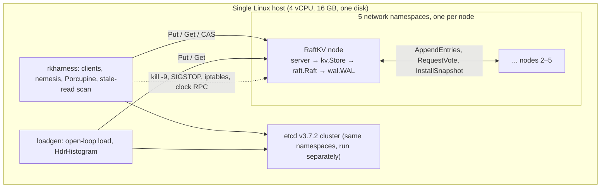
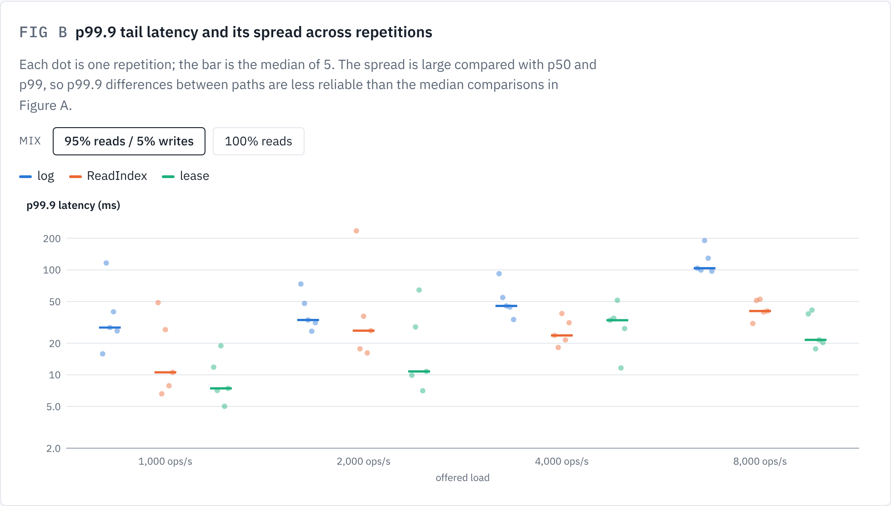
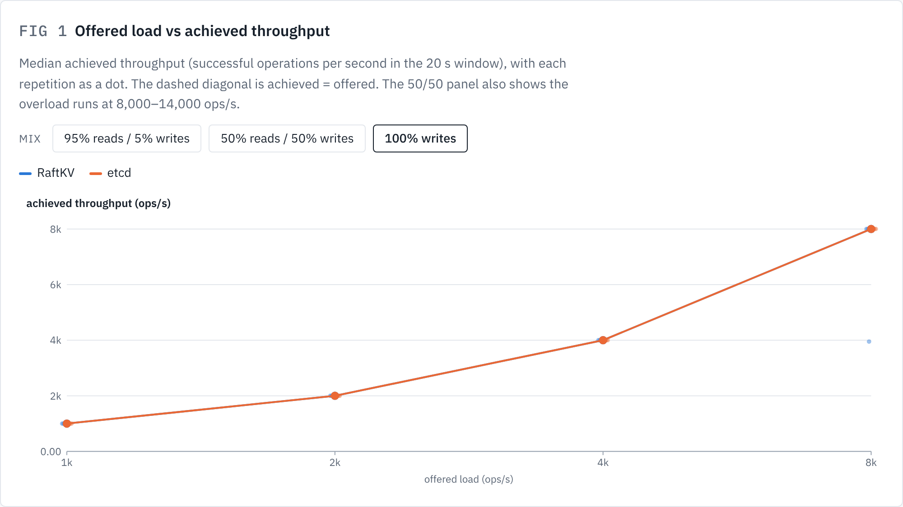
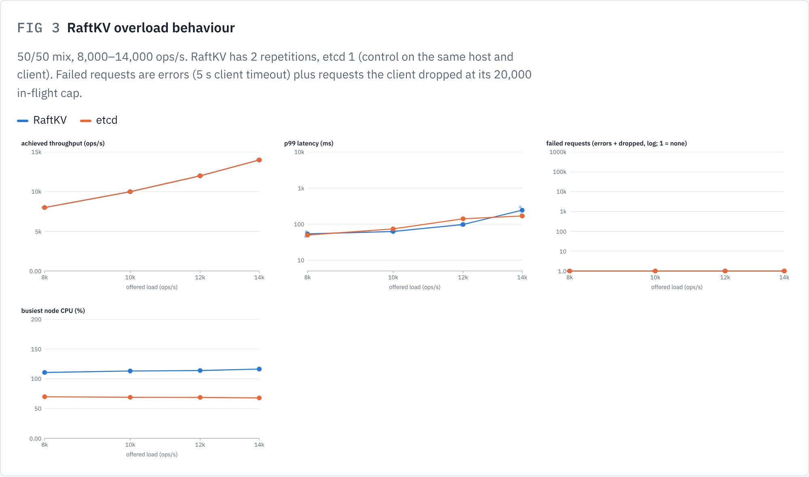
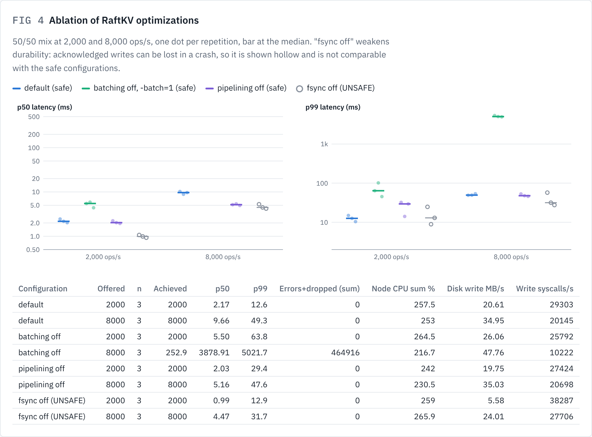
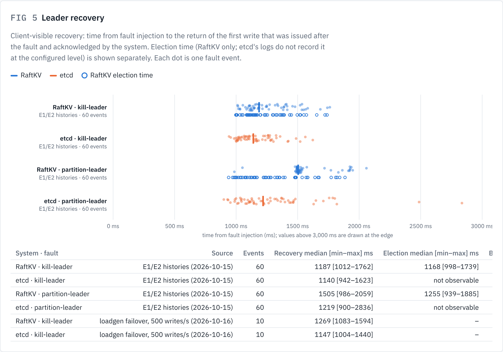

# RaftLab: Correctness and Cost of a From-Scratch Raft Key-Value Store, Measured Against etcd

Final research report, 16 October 2026. Author: Maria Malinka.

Code: this repository, GitHub `main` at `14bf0f6`. Every number in this report is taken from a report or raw result in `results/`; the source is named next to each table.

---

## 1. Abstract

Consensus protocols such as Raft are the foundation of strongly consistent distributed storage, yet implementing them correctly is notoriously difficult, and the cost of each correctness mechanism is rarely measured in isolation. RaftLab is a five-node replicated key-value store (RaftKV) written from scratch in Go, with a switchable read path (log reads, ReadIndex, leader leases), switchable performance mechanisms (batching, pipelining, fsync) and seven deliberately injectable Raft bugs. It is evaluated with a custom fault-injection harness (process kills, pauses, network partitions in Linux network namespaces, simulated clock faults and lost unsynced writes), the Porcupine linearizability checker and a conservative stale-read detector, and compared with etcd v3.7.2 under the same harness and load generator.

The Raft test suite passed 1,500 of 1,500 runs. Under nine fault scenarios RaftKV produced 180 of 180 linearizable histories with ReadIndex reads, and etcd, used as a control, produced no confirmed violation in 160 trials. Leader-lease reads stayed linearizable in 60 of 60 trials with the leader's clock slowed to 0.92×, and returned stale values in 3 of 3 trials at 0.25×, which is far outside the lease's assumed drift bound. In a limited bug-injection study the harness detected two injected bugs at rates of 19/19 and 14/16 with no false positives in 40 control trials, although detection relied on the stale-read scan because Porcupine was mostly inconclusive. RaftKV had lower median latency than etcd at all 12 tested load points, but it lacks backpressure and collapsed intermittently under write overload, which etcd did not. Batching is essential for throughput, pipelining gave no benefit on a single host, and leader recovery took about 1.1–1.5 s in both systems. The harness also found a real durability bug in RaftKV (R-1), which was fixed and covered by regression tests. All results come from one 4-vCPU host with reduced repetitions in several experiments, and they are empirical evidence, not proof of correctness.

## 2. Introduction

A distributed key-value store replicates its data so that it survives the failure of individual machines. Replication only helps if the replicas agree: a client that writes a value and then reads it back must not see an older value, even if the server it talked to has just crashed or been cut off from the network. *Linearizability* [Herlihy and Wing] makes this precise: every operation must appear to take effect atomically at some instant between its invocation and its response. Consensus algorithms such as Paxos and Raft provide the replicated log on which linearizable stores are built. Raft [Ongaro and Ousterhout] was designed for understandability, and its specification (Figure 2 of the paper) fits on one page. Experience shows that implementations nevertheless fail in subtle ways, typically under rare interleavings of crashes, network partitions and timing.

Production systems such as etcd have been tested extensively, most visibly by Jepsen. Student and research implementations usually report that "no anomalies were found", which says little unless the test method is itself shown to find anomalies when they exist. A second gap is cost: correctness mechanisms such as quorum reads, fsync before acknowledgement or a round trip to confirm leadership have a price, and that price is easier to measure in an implementation where each mechanism can be switched off.

RaftLab addresses both gaps. It implements Raft and a key-value state machine from scratch, with every relevant mechanism behind a flag, and measures:

- whether the store stays linearizable under a broad set of faults (RQ1);
- what each mechanism costs and how the store compares with etcd, a mature Raft-based system run as a control on the same machine (RQ2);
- whether the test harness can detect known Raft bugs that are injected on purpose (RQ3).

The project follows a research plan written at its start (*Raft KV Store vs etcd — Research Plan*, 9 October 2026). This report consolidates all experiments run under that plan. Section 3 states the research questions, Sections 4 and 5 describe the system and the method, Sections 6–12 present results, and Sections 13–15 discuss them, list threats to validity and conclude.

## 3. Research questions and hypotheses

The research questions and hypotheses are quoted from the plan.

> **RQ1. Correctness.** Does the store produce only linearizable histories under process crashes, network partitions, process pauses and clock skew?
>
> **RQ2. Cost of correctness.** How much latency and throughput does each mechanism cost — quorum reads vs ReadIndex vs leader leases, fsync policy, batching — and how does that compare with etcd's choices?
>
> **RQ3. Testing efficacy (the novel part).** How good is a Jepsen-style harness at finding real Raft bugs? Inject known bugs on purpose and measure which fault schedules catch them, and how fast.

> **H1.** Lease-based reads stay linearizable without clock faults but break under injected clock skew; ReadIndex reads do not.
>
> **H2.** Partition faults expose more injected bugs than crash faults alone, and combined fault schedules expose the most.
>
> **H3.** Most of the throughput gap with etcd comes from batching and disk sync policy, not from Raft itself. Matching those settings should close most of it.

The plan maps eight experiments to these questions: E1 (RaftKV linearizability, RQ1), E2 (etcd control, harness validity), E3 (latency vs load, RQ2), E4 (failover and recovery, RQ2), E5 (read paths, H1), E6 (bug-injection detection, RQ3 and H2), E7 (ablation, H3) and E8 (etcd unsafe settings, context), plus a gate G1 (the Raft unit suite passes 500 consecutive runs).

**Coverage.** RQ1 is fully investigated (G1, E1, E2 and the correctness side of E5). RQ2 has substantial but reduced coverage: E5 is complete at reduced size, while E3, E4 and E7 were run with fewer workloads and repetitions than planned. RQ3 has limited coverage: only 2 of the 7 injected bugs were measured, each under a single fault, so H2 could not be tested. E8 was not run. Table 1 gives the details.

**Table 1. Experimental coverage.**

| ID | Planned | Actually run | Status | Commit | Source |
|---|---|---|---|---|---|
| G1 | Raft suite 500× per mode | 500× in 3 modes, race detector | Completed | `3055bd5` | `results/G1-E6-readiness-2026-10-14/` |
| E1 | 20+ trials per nemesis | 9 scenarios × 20 trials | Completed | `80f06fc` | `results/E1-E2-2026-10-15/` |
| E2 | same harness on etcd | 8 scenarios × 20 trials | Completed (no clock faults, no LazyFS) | `80f06fc` | `results/E1-E2-2026-10-15/` |
| E3 | 3 mixes × 2 value sizes × 2 key distributions, 3 and 5 nodes, netem delay, 5 reps | 3 mixes × 4 loads, 128 B, uniform, 5 nodes, 4–7 reps, plus overload runs | Partial | `14bf0f6` | `results/RQ2-2026-10-16/` |
| E4 | failover gap, catch-up with and without snapshots | kill-leader (10 new + 60 re-analysed events per system), partition-leader (60 re-analysed) | Partial | `14bf0f6` | `results/RQ2-2026-10-16/` |
| E5 | 3 read paths with and without clock skew, speed vs correctness | 27-trial pilot, 60-trial lease extension, 40 benchmark runs | Completed at reduced size | `14bf0f6` | `results/E5-pilot-2026-10-16/`, `results/E5-extended-2026-10-16/` |
| E6 | 7 bugs × all faults × 20 trials (74 cells) | 2 bugs × 1 target fault × 20 trials + 2 controls × 20 | Limited | `85a3e22` | `results/E6-limited-2026-10-15/` |
| E7 | batching, pipelining, fsync on/off vs etcd | 4 configurations × 2 loads × 3 reps, 50/50 mix | Partial | `14bf0f6` | `results/RQ2-2026-10-16/` |
| E8 | etcd serializable reads under partition | — | Not run | — | — |

The production code (`internal/raft/raft.go`, `internal/kv`, `internal/wal`) is identical at `00d9651`, `3055bd5`, `85a3e22`, `80f06fc` and `14bf0f6` (`git diff` between them is empty for those paths). Only tests, scripts, analysis code and results changed after the R-1 fix in `00d9651`, so all experiments in this report test the same implementation.

## 4. System design and implementation

### 4.1 Architecture

RaftKV runs as five node processes (`cmd/raftkv`). Each node has four layers (Figure 1): a gRPC server, the key-value state machine, the Raft module and the write-ahead log. Clients use a library (`client/`) that discovers the leader, retries and tags writes for deduplication. The harness and the load generator drive either RaftKV or etcd through the same interface.

*Figure 1. Components of RaftLab. Only one system (RaftKV or etcd) runs at a time.*

### 4.2 Consensus

The Raft module (`internal/raft/raft.go`) follows the Raft paper's Figure 2 and the thesis's extensions:

- **Election.** Randomised timeouts in [T, 2T) with T = 1 s (`resetElectionTimer`, line 374), votes persisted before they are granted (`HandleRequestVote`, line 749), check-quorum (a leader steps down if it cannot reach a majority within T), and *vote stickiness*: a node that heard from a live leader within T, or that restarted less than T ago, refuses to vote for a higher term (`inLease`, line 722). Stickiness is required for lease safety.
- **Replication.** AppendEntries with conflict-term backtracking, a no-op entry at the start of each term so that ReadIndex and leases can require a committed entry from the current term, optional pipelining with up to 8 requests in flight per follower, and batching of up to 256 entries per request.
- **Commit.** An entry is committed when a majority, counting the leader only for entries it has made durable, has stored it, and only entries of the current term are committed by counting replicas (`maybeCommit`, line 527).
- **Persistence discipline.** All disk writes go through one persister goroutine in log order, which groups everything queued into one fsync (group commit). RPC handlers that promise durability wait for the persister before replying. Since the R-1 fix (Section 12), a follower replies `Success` to AppendEntries only after every write queued so far is durable (lines 872–887).

### 4.3 Persistent storage

The write-ahead log (`internal/wal/wal.go`) stores records of the form `crc32c | length | type | payload` for hard state (term and vote), entries and truncations. Recovery replays records until the first bad checksum and truncates the torn tail. Snapshots are written to a temporary file, fsynced and renamed, and the log is rewritten without the compacted prefix. A lagging follower whose entries were compacted receives a snapshot through `InstallSnapshot`. The `-fsync=false` flag disables fsync (unsafe, used only as a labelled ablation). The `-lazyfs` flag keeps unsynced records in process memory so that `kill -9` loses them, standing in for the LazyFS file system, which was not used.

### 4.4 Client operations

The state machine (`internal/kv/store.go`) is an in-memory map supporting `Put`, `Get` and `CAS`. Every write carries a client ID and sequence number; the state machine stores the last sequence number and result per client and returns the cached result for a duplicate (line 248). A client operation whose outcome is unknown (timeout, connection error, or a leader change after proposing) is reported as *indeterminate*. The harness records such operations as `info`, which the checker treats as possibly applied; they are never counted as failures. Harness clients are bound to a home node, as Jepsen processes are; followers answer `not_leader` with a hint.

### 4.5 Read paths

`Get` has three implementations, selected with `-read-mode` (`Store.Get`, `internal/kv/store.go:367`):

| Read path | Mechanism | Cost per read | Safety assumption |
|---|---|---|---|
| `log` | The read is proposed as a log entry and answered when applied | One replication round and one fsync | None beyond Raft |
| `readindex` (default) | The leader records the commit index, confirms leadership with one round of AppendEntries acknowledged by a majority, waits until the index is applied, reads locally (`ReadIndex`, `raft.go:978`) | One network round, no disk write | None beyond Raft |
| `lease` | If a majority acknowledged messages sent within `T × (1 − 0.1)` on the leader's clock, the leader reads at the commit index without a round; otherwise it falls back to ReadIndex (`LeaseRead`, `raft.go:1025`) | None while the lease holds | Clock drift below the configured bound (10%) |

The lease is safe because followers refuse to vote for a new leader until T has passed on their own clocks since they last heard from the leader. If the leader's clock runs slower than the followers' by more than the drift bound, its lease can outlast that embargo.

### 4.6 Fault-injection infrastructure

The harness (`harness/`, CLI `cmd/rkharness`) places each node in its own Linux network namespace connected by a bridge (`harness/netns.go`) and injects faults from a schedule (`harness/nemesis.go`):

| Fault | Effect |
|---|---|
| `kill-leader`, `kill-majority`, `kill-all`, `kill-random` | `kill -9`, restart at heal; with `-lazyfs`, unsynced WAL writes are lost |
| `pause-leader`, `pause-random` | `SIGSTOP`, then `SIGCONT` at heal |
| `partition-leader`, `partition-halves`, `partition-bridge` | `iptables` rules: isolate the leader, a random 2/3 split, or two halves joined by one bridge node |
| `bridge-churn` | `partition-bridge` with the bridge node killed and restarted every 100–400 ms |
| `clock-skew` | Random nodes jump by up to ±2 T and run at 0.25×–4× speed (RaftKV only) |
| `clock-partition`, `clock-partition-mild` | The leader's clock is slowed to 0.25× or 0.92×, then the leader is isolated (RaftKV only) |
| `mixed` | Each round draws one of the process, partition or clock faults |

Clock faults use an in-process skewable clock (`internal/clock/clock.go`) controlled over an admin RPC, instead of libfaketime. The seven injectable bugs (`internal/bugs/`) are compiled only with `-tags bugs` and enabled with the `RAFTKV_BUGS` environment variable; in normal builds they are constant `false` and compiled out.

### 4.7 Linearizability verification

Each trial runs a register workload: 25 clients issue reads, writes and CAS operations (one third each) on two active keys, moving to fresh keys every 12 s, with a unique value for every write. The checker (`harness/checker.go`) uses Porcupine with a nondeterministic register model partitioned by key, in which indeterminate writes may or may not take effect. Each trial has one of four outcomes:

- **Ok:** the full Porcupine check passed within the 60 s timeout.
- **Ok (reduced):** the full check timed out, and every key then passed a check from which the indeterminate writes and CASes whose values no completed operation observed were removed (`reduce`, line 247; `reduceKey`, line 277). This is sound for Ok: a removed operation can always be linearized as having had no effect. It counts as a pass but is reported separately.
- **Unknown:** undecided even after the reduction. Never counted as a pass.
- **Illegal:** the full check found a non-linearizable history. A reduced check never produces Illegal.

Independently of Porcupine, a **conservative stale-read scan** (`harness/stale.go`) flags a read whose value no write could have produced: a newer write had already completed before the read was invoked, and no write overlapping that window wrote the returned value. With unique values, a flagged read is a proof of non-linearizability. The scan cannot detect anomalies other than stale reads.

### 4.8 Benchmarking infrastructure

The load generator (`cmd/loadgen`, `bench/`) is open-loop: requests are issued at a fixed arrival rate and latency is measured from each request's intended start time, which avoids coordinated omission. Latency is recorded with HdrHistogram. RaftKV is driven through its client library, etcd through the official Go client (`clientv3`), in the same process. A failover mode kills the leader repeatedly and measures the time to the first successful write. Each benchmark repetition starts a fresh cluster, preloads 10,000 keys and measures for 20 s after a 5 s warmup.

## 5. Experimental methodology

### 5.1 Environment

All experiments ran in one Linux container: 4 vCPU, 16 GB RAM (memory limit about 13.8 GB), one disk, kernel 6.18.44, Go 1.26.0 linux/amd64. The five nodes, the harness or load generator and the checker share this host. The network is a local bridge between namespaces with sub-millisecond latency; `tc netem` was not available, so no network-delay experiments were run.

### 5.2 Cluster configuration

| Setting | RaftKV | etcd v3.7.2 |
|---|---|---|
| Nodes | 5 | 5 |
| Election timeout / heartbeat | 1 s / 100 ms | 1 s / 100 ms |
| Reads | ReadIndex (E1, E3, E4, E7); log, ReadIndex, lease (E5) | linearizable (default, not serializable) |
| Durability | fsync before acknowledging | fsync (default) |
| Batching / pipelining | batch 256, pipelining on (E7 varies them) | built in |
| Snapshots | every 256 KB of WAL (harness setting; the node default is 64 MB) | `--snapshot-count 10000` |
| Log level | info | warn |
| Clock faults | in-process skewable clock | not supported |
| Lost unsynced writes | `-lazyfs` WAL mode | not supported (a `SIGKILL` keeps etcd's page cache) |

### 5.3 Workloads and fault schedules

**Correctness trials (E1, E2, E5, E6).** Every trial uses the same line of settings (the `E6H` line of `scripts/experiment.sh`): 5 nodes, 25 clients bound to home nodes, a 34 s workload with 3 s warmup, faults starting at 3, 15 and 27 s and lasting 5 s each, 5 s recovery, 12 s key epochs with 2 active keys, unique write values, 1 s operation timeout and a 60 s checker timeout. Each trial uses a fresh cluster and its own `rkharness -trials 1` process, so a checker crash costs only that trial. The harness records planned, executed and completed faults per trial.

**Benchmarks (E3, E5, E7).** Open loop, 10,000 keys, 128 B values, uniform key choice, offered loads of 1,000, 2,000, 4,000 and 8,000 ops/s (and 8,000–14,000 for overload), read fractions 1.0, 0.95, 0.5 and 0 depending on the experiment, a 5 s client timeout and a 20,000-request in-flight cap. A 1 s sampler recorded CPU, memory, CPU and I/O pressure and disk writes per process.

### 5.4 Trial counts

| Experiment | Trials or repetitions |
|---|---|
| G1 | 500 runs × 3 modes |
| E1 / E2 | 20 trials per scenario (180 / 160) |
| E5 pilot | 3 trials per read path × clock condition (27); speed: 2 reps |
| E5 extension | 60 lease trials at 0.92×; speed: 5 reps × 3 paths × 2 mixes × 4 loads |
| Limited E6 | 20 attempts per cell, 4 cells |
| E3 | 95/5: RaftKV 7 reps (5 reused from the E5 extension, same commit and method, plus 2 new), etcd 5; 50/50 and write-only: 4 reps |
| Overload | RaftKV 2 reps, etcd 1 rep (50/50, 8k–14k); RaftKV write-only 1 rep |
| E7 | 3 reps |
| E4 | 10 leader kills per system (new) + 60 events per system and fault re-analysed from E1/E2 |

### 5.5 Metrics

Correctness trials report the checker outcome, the number of provably stale reads, the number of client operations by result (ok, fail, info), fault counts and durations, and peak checker memory. Benchmarks report achieved throughput, errors and dropped requests, p50, p99 and p99.9 latency, CPU, memory and disk writes. E4 reports client-visible recovery (time from fault injection to the return of the first write issued after the fault and acknowledged by the system) and, for RaftKV, election time (the first `became leader` with a higher term in the node logs).

### 5.6 Handling Unknown results and checker crashes

The original Porcupine verdicts are preserved in every table. Unknown and checker crashes are inconclusive: they are never counted as correct and are reported in their own columns. Offline rechecks (per-key checks with more time, partial reduction, prefix cuts) were run on some inconclusive histories with test code outside the harness; their findings are reported separately and do not change any verdict. Two detection rates are used for injected bugs (decided on 15 October 2026): the **combined** rate counts a trial as detected if it is Illegal or has at least one provably stale read, over all completed trials with Unknown kept in the denominator; the **Porcupine-only** rate counts Illegal over Ok + Ok (reduced) + Illegal.

### 5.7 Statistics

Rates are reported with Wilson 95% score intervals (`harness/runner.go:250`). A 0/20 cell has an upper bound of 0.16, 0/60 an upper bound of 0.060, and a 3/3 cell a lower bound of 0.44. Benchmark points are the median over repetitions with the minimum–maximum range. The plan asked for a confidence interval per point; with 3 to 7 repetitions, min–max ranges are reported instead, and a comparison is called reliable only when the ranges of the two configurations do not overlap.

### 5.8 Pilot and final measurements

Several experiments were first run as pilots: the 9 October pilot of E1, E2, E5 and E6 (3 trials of 20 s), the 9 October rerun, the 10 October fault-schedule validation, the 11 October post-fix verification (including benchmarks), and the E5 pilot of 16 October. Those reports are kept unchanged in `results/` and `docs/`. The final results in this report are E1/E2 (15 October), limited E6 (15 October), the E5 extension and RQ2 runs (16 October). Where a pilot and a final run differ, the difference is explained in the relevant section.

## 6. Correctness results: G1, E1 and E2

### 6.1 G1: Raft unit suite

The Raft test suite (`internal/raft` at `3055bd5`: 36 tests, namely 27 tests in the 6.5840-style suite, 2 durability tests, 4 persistence-audit tests and 3 white-box bug tests) was compiled with the race detector and run 500 times in each of three modes at commit `3055bd5` (`results/G1-E6-readiness-2026-10-14/REPORT.md`).

| Mode | Runs | Passed | Failed | Race warnings | Mean run |
|---|---|---|---|---|---|
| default | 500 | 500 | 0 | 0 | 156.7 s |
| `-pipeline` | 500 | 500 | 0 | 0 | 154.1 s |
| `-batch=1` | 500 | 500 | 0 | 0 | 175.0 s |

All **1,500 of 1,500** runs passed. One deviation from `scripts/g1.sh`: runs were 8-way parallel per mode (24 processes on 4 vCPU), which can only make timing-sensitive tests harder. In addition, `make bugtests` confirms that each of the seven injected bugs makes its deterministic test fail (7/7 caught at every experiment commit).

### 6.2 E1: RaftKV linearizability

**Table 2. E1 (RaftKV, ReadIndex) and E2 (etcd) outcomes per scenario** (`results/E1-E2-2026-10-15/REPORT.md`).

| Scenario | E1 Ok + Ok (red.) | E2 Ok + Ok (red.) | E2 inconclusive | Illegal E1 / E2 | Stale reads E1 / E2 |
|---|---|---|---|---|---|
| kill-leader | 16 + 4 | 19 + 1 | 0 | 0 / 0 | 0 / 0 |
| kill-majority | 17 + 3 | 10 + 10 | 0 | 0 / 0 | 0 / 0 |
| kill-all | 16 + 4 (LazyFS) | 16 + 4 (no LazyFS) | 0 | 0 / 0 | 0 / 0 |
| pause-leader | 16 + 4 | 4 + 16 | 0 | 0 / 0 | 0 / 0 |
| partition-leader | 14 + 6 | 2 + 15 | 2 Unknown, 1 crash | 0 / 0 | 0 / 0 |
| partition-halves | 14 + 6 | 1 + 19 | 0 | 0 / 0 | 0 / 0 |
| partition-bridge | 16 + 4 | 8 + 12 | 0 | 0 / 0 | 0 / 0 |
| clock-skew | 19 + 1 | not run | – | 0 / – | 0 / – |
| mixed | 19 + 1 | 8 + 11 | 1 Unknown | 0 / 0 | 0 / 0 |
| **Total** | **147 + 33 = 180/180** | **68 + 88 = 156/160** | **4** | **0 / 0** | **0 / 0** |

All 180 RaftKV trials were linearizable, with 0 Unknown, 0 Illegal, 0 provably stale reads and 0 checker crashes. The trials contained 5,499,649 client operations, of which 0.37% were indeterminate. All 540 planned faults executed and completed, each lasting at least 5.00 s. The 95% upper bound on the violation rate is 0.16 per scenario and 0.02 pooled.

### 6.3 E2: the etcd control

etcd ran 8 of the 9 scenarios (no clock-skew, because etcd has no equivalent of the skewable clock; kill-all without LazyFS). In the mixed scenario, 5 of 60 fault rounds drew the unsupported clock-partition fault and injected nothing. 156 of 160 trials were linearizable as judged by the harness; there were 0 Illegal results and 0 provably stale reads, so the harness produced no false positive on a production system. The remaining 4 trials keep their original verdicts: 3 Unknown and 1 checker crash (out of memory at 13.8 GB). An offline per-key recheck (`analysis/offline-recheck/`) shows all 4 histories are linearizable: the crashed trial's keys are each Ok (reduced) when checked separately, one Unknown key is Ok when checked alone without reduction, and the other two become Ok when one of the dropped indeterminate writes is added back to the reduced check.

### 6.4 The role and limits of Ok (reduced) and offline rechecks

Ok (reduced) accounts for 33 of 180 RaftKV trials and 88 of 160 etcd trials. It is a sound pass, but only in one direction: removing unobserved indeterminate writes can turn a linearizable history into one the reduced check calls Illegal, because a removed write may be exactly what explains a later failed CAS. This happened in two of the etcd histories, which is why a reduced Illegal is never reported as a violation. etcd histories needed the reduced check more often and used much more checker memory (median peak 3.2–7.4 GB in the pause, partition and mixed cells, against 0.03–0.33 GB for RaftKV), probably because etcd produced 1.3–3.3 times more indeterminate operations in those scenarios (0.65% overall against 0.37%). This explanation is inferred, not measured directly.

These results support RQ1 for RaftKV with ReadIndex reads under the tested faults. They are not a proof of correctness: the evidence covers 5 nodes, 34-second runs, one machine, two active keys per epoch, and these fault types and durations.

## 7. Read-path evaluation: E5

### 7.1 Design

Every E5 correctness trial isolates the current leader, so the three clock conditions differ only in the isolated leader's clock rate (`results/E5-pilot-2026-10-16/REPORT.md`):

| Condition | Fault | Leader clock | Lease in real time | Prediction |
|---|---|---|---|---|
| normal | partition-leader | 1.00× | 0.9 s | safe |
| mild | clock-partition-mild | 0.92× | 0.9 / 0.92 = 0.978 s, about 2% before followers may vote at 1 s | safe |
| severe | clock-partition | 0.25× | 0.9 / 0.25 = 3.6 s, while a new leader is elected after 1–2 s | unsafe |

### 7.2 Correctness

**Table 3. E5 correctness** (pilot: 3 trials per cell; extension: 60 trials).

| Read path | Condition | Trials | Ok / Ok (red.) / Unknown / Illegal | Trials with stale reads | Combined violation rate [95% CI] |
|---|---|---|---|---|---|
| log | normal / mild / severe | 3 / 3 / 3 | all 9 Ok or Ok (red.) | 0 | 0/3 each [0, 0.56] |
| ReadIndex | normal / mild / severe | 3 / 3 / 3 | all 9 Ok or Ok (red.) | 0 | 0/3 each [0, 0.56] |
| lease | normal | 3 | 1 / 2 / 0 / 0 | 0 | 0/3 [0, 0.56] |
| lease | mild (pilot) | 3 | 1 / 2 / 0 / 0 | 0 | 0/3 [0, 0.56] |
| **lease** | **mild (extension)** | **60** | **20 / 38 / 2 / 0** | **0** | **0/60 [0, 0.060]** |
| **lease** | **severe** | **3** | **0 / 0 / 3 / 0** | **3 (75 stale reads)** | **3/3 [0.44, 1.00]** |

**Lease under mild drift.** In the 60-trial extension, all 180 faults executed and completed, there were no checker crashes, and the offline stale scan agreed with the harness in every trial. The two Unknown trials keep their verdicts; offline, one key became Ok when checked alone and the other became Ok when one dropped write was added back, so all 60 histories are known to be linearizable. The Porcupine-only rate is 0/58 [0, 0.062]. Zero violations in 60 trials bounds the per-trial violation probability below 6.0% at 95% confidence; it does not show that it is zero. One attempt was interrupted by a container restart and rerun; the interrupted copy is kept and also had 0 stale reads.

**Lease under severe drift.** All three trials had provably stale reads (27, 21 and 27), and Porcupine returned Unknown for all three; offline per-key and prefix rechecks also stayed Unknown, so the evidence is the stale-read scan alone. Every one of the 75 stale reads was served by the slowed, isolated old leader, between 1.52 and 3.35 s after the fault started (`analysis/stale-windows.txt`). This window runs from the new majority leader's first committed writes (about 1.5 s) to the end of the slowed lease (about 3.6 s). No stale read occurred outside a fault window.

**Assumption violation, not implementation defect.** A 0.25× clock is a 75% drift, far beyond the 10% bound the lease is designed to tolerate; inside the bound (0.92×) there were no violations. ReadIndex and log reads, which do not depend on clocks, were correct under the identical 0.25× fault. The stale reads appear exactly in the window the lease arithmetic predicts. The result therefore demonstrates what happens when the lease's clock assumption is violated. A genuine lease defect looks different: the injected `leasenodrift` bug, which trusts the full timeout without the drift margin, produced an Illegal result inside the bound (0.92×) in a 3-trial readiness smoke run (`results/G1-E6-readiness-2026-10-14/E6-READINESS-AUDIT.md`). This also agrees with the 9 October pilot, where lease reads were Illegal in 3/3 trials under clock-partition (`results/pilot-2026-10-09/REPORT.md`).

*Figure 2. Lease safety near the drift boundary (E5 Figure C). The 0.92× point is the 60-trial extension; the other two are 3-trial pilot reference points and are not pooled.*

### 7.3 Performance

**Table 4. Read-path latency without faults** (E5 extension, median of 5 repetitions, ms; `results/E5-extended-2026-10-16/REPORT.md`). All 40 runs reached the offered load with 0 errors, timeouts or drops.

| Mix | Load (ops/s) | log p50 / p99 | ReadIndex p50 / p99 | lease p50 / p99 |
|---|---|---|---|---|
| 95/5 | 1,000 | 2.08 / 10.86 | 1.13 / 3.81 | 0.89 / 3.05 |
| 95/5 | 2,000 | 3.17 / 14.31 | 1.21 / 7.36 | 0.64 / 3.35 |
| 95/5 | 4,000 | 4.80 / 31.44 | 2.47 / 11.07 | 0.42 / 3.96 |
| 95/5 | 8,000 | 8.43 / 71.30 | 5.04 / 22.62 | 0.74 / 8.70 |
| 100% reads | 1,000 | 2.06 / 10.26 | 1.08 / 3.27 | 0.85 / 1.94 |
| 100% reads | 2,000 | 3.27 / 17.57 | 0.93 / 4.74 | 0.58 / 2.35 |
| 100% reads | 4,000 | 4.61 / 28.27 | 1.63 / 7.54 | 0.36 / 1.71 |
| 100% reads | 8,000 | 7.31 / 52.77 | 3.17 / 12.81 | 0.35 / 2.30 |

At p50 the ordering lease < ReadIndex < log holds at all 8 points with non-overlapping ranges. At p99 it holds at 7 of 8 points for each pair; the exceptions are lease vs the others at 100% reads and 1,000 ops/s (one lease repetition had p99 = 42 ms) and ReadIndex vs log at 95/5 and 2,000 ops/s. The lease's p50 advantage over ReadIndex grows with load, from 1.3× at 1,000 ops/s to 6.8× (95/5) and 9.1× (100% reads) at 8,000 ops/s; over log reads it reaches 11.4× and 20.9×. Part of this growth is CPU contention: log reads use about 235–250% CPU across the nodes and ReadIndex 170–270%, both under heavy CPU pressure (64% median), whereas lease uses 46–182%. The absolute ratios are therefore specific to this host. In the 95/5 mix the histogram includes the writes, which always go through the log, so write latency is not reported separately.

**Tail latency.** p99.9 could not be ordered reliably: lease vs ReadIndex was separated at 0 of 8 points and log vs the others at 2 of 8, so p99.9 results are preliminary (Figure 3 shows the spread). The outlier analysis found no association between tail spikes and snapshots (median relative p99.9 of 1.00 with and without a snapshot in the window), found that GC pauses of 29–39 ms explain some but not all lease p99.9 spikes at 8,000 ops/s, and attributes the log and ReadIndex tails mainly to CPU scheduling contention (inferred, not proven).

**Pilot vs extension.** The pilot (2 repetitions) reported somewhat lower latencies, for example 8,000 ops/s pure reads at p50 0.31 / 2.48 / 5.87 ms (lease / ReadIndex / log) against 0.35 / 3.17 / 7.31 ms in the extension. The extension is the final measurement: it has 5 repetitions, a resource sampler running alongside (its overhead appears small but was not measured separately), and different load points. The pilot's 181 ms log p99 at 1,000 ops/s did not recur (6.9–12.6 ms over 5 repetitions), and its lower lease p50 at 4,000 than at 1,000 ops/s is reproduced in the extension (0.36 vs 0.85 ms at 100% reads), which suggests a low-load effect such as idle wakeups rather than noise. This was not investigated further.

*Figure 4. Read latency vs offered load, 95/5 mix (E5 Figure A). The interactive original also shows the 100%-reads mix.*

*Figure 3. p99.9 latency and its spread across repetitions (E5 Figure B).*

## 8. Fault-injection effectiveness: limited E6

### 8.1 The seven injected bugs

**Table 5. Injected bugs, their deterministic tests and the scope actually measured.**

| Bug flag | Plan's description | Expected effect | Deterministic test | Measured in limited E6 |
|---|---|---|---|---|
| `figure8` | Commit previous-term entries by counting replicas | Committed write lost | `TestBugFigure8` | No |
| `localread` | Serve reads on the leader without a quorum check | Stale read | `TestBugLocalRead` | **Yes**, partition-leader |
| `leasenodrift` | Lease read without a clock-drift bound | Stale read | `TestBugLeaseNoDrift` | No |
| `votenopersist` | Grant a vote before persisting votedFor | Two leaders in one term | `TestBugVoteNoPersist` | No |
| `notruncate` | Skip truncating a conflicting log suffix | Divergent state machines | `TestBugNoTruncate` | No |
| `nodedup` | Apply a retried request twice | Duplicate write | `TestBugNoDedup` | No |
| `ackbeforefsync` | Acknowledge before fsync | Lost acknowledged write | `TestBugAckBeforeFsync` | **Yes**, kill-all + LazyFS |

Each deterministic test fails with its bug enabled and passes without it (`make bugtests`). A 3-trial readiness smoke of each bug (`results/G1-E6-readiness-2026-10-14/`) found that `figure8` and `notruncate` are expected blind spots of the current fault schedules, that `votenopersist` has no fault that reaches it (the restart vote embargo prevents a same-term double vote; 0 two-leader terms observed), that `nodedup` should have a low rate, and that `leasenodrift` and `localread` produced Illegal results in 1 of 3 trials each. These smoke runs are too small for rates and are not E6 results.

### 8.2 Scope and results

On 15 October 2026 it was decided not to run the full matrix (74 bug × fault cells × 20 trials, estimated at 28 hours) and to validate the method on the two bugs whose smoke runs had been inconclusive. Each bug ran under its target fault from the plan's bug table, and each control was the bug-free build with exactly the same flags (`results/E6-limited-2026-10-15/REPORT.md`, commit `85a3e22`).

**Table 6. Limited E6.**

| | ackbeforefsync (kill-all, LazyFS) | control (LazyFS) | localread (partition-leader) | control |
|---|---|---|---|---|
| Attempts | 20 | 20 | 20 | 20 |
| Completed | 19 | 20 | 16 | 20 |
| Checker crash (out of memory) | 1 | 0 | 4 | 0 |
| Ok / Ok (reduced) | 0 / 0 | 18 / 2 | 1 / 1 | 16 / 4 |
| Unknown | 19 | 0 | 13 | 0 |
| Illegal | 0 | 0 | 1 | 0 |
| Trials with provably stale reads | 19/19 (160 reads) | 0/20 | 14/16 (48 reads) | 0/20 |
| **Combined detection [95% CI]** | **19/19 = 1.00 [0.83, 1.00]** | 0/20 [0, 0.16] | **14/16 = 0.88 [0.64, 0.97]** | 0/20 [0, 0.16] |
| Porcupine-only detection | 0/0, undefined | 0/20 | 1/3 = 0.33 [0.06, 0.79] | 0/20 |
| Median time of first stale read | 9.1 s | – | 4.7 s | – |
| Porcupine detection time | – | – | 4.2 s (n = 1) | – |

**Porcupine-only, stale-read and combined detection.** With unique values and histories that contain violations, Porcupine almost always timed out: it reached a verdict in none of the ackbeforefsync trials and in 3 of 16 localread trials. The Porcupine-only rate therefore measures the checker's limits more than the harness's ability to expose bugs. The stale-read scan detected both bugs, and the combined rate is the primary metric. Every node start in every completed bug trial logged the requested bug, and the stale reads show the bugs' effects directly: acknowledged writes lost after a crash for ackbeforefsync, and the isolated old leader answering reads for localread. Neither control produced a single stale read or Illegal result, so the false-positive rate of either detector is below about 0.16 (95%).

**Checker crashes.** Five harness processes were killed while checking, four confirmed by the kernel's out-of-memory log at 13.8–13.9 GB. They are counted as crashes, not as any verdict. An offline scan of their saved histories finds stale reads in all 5; this is reported only and is in no rate.

### 8.3 Interpretation

The limited E6 supports a focused RQ3 claim: under its target fault, each of two known Raft bugs was detected with probability at least 0.83 (ackbeforefsync) and 0.64 (localread) at the 95% lower bound, with zero false positives in 40 control trials. It does not quantify the detection of the other five bugs, it says nothing about which faults expose which bugs, and so it leaves H2 untested.

**Pilot vs final.** The 9 October E6 pilot detected 0 of 7 bugs (`results/pilot-2026-10-09/REPORT.md`). The investigation of that negative result found two harness blind spots, recorded in `docs/BUG_JOURNAL.md` as H-1 and H-2: clients chased the new leader and never read from the deposed one, and keys rotated every 5 s with only 5 possible values, so lost writes were never re-read and a stale read could always be explained by an indeterminate write. Binding clients to home nodes, longer key epochs and unique values fixed this; ackbeforefsync then became visible in 3/3 trials of the rerun (`results/rerun-2026-10-09/REPORT.md`). The pilot's 0/7 is therefore a finding about the original workload, and the limited E6 measures the corrected harness.

## 9. Performance comparison: E3

### 9.1 Latency and throughput

**Table 7. RaftKV (ReadIndex) vs etcd, median latency in ms** (`results/RQ2-2026-10-16/analysis/bench.md`). Achieved throughput equalled offered load at every point except one RaftKV repetition (below). p99.9 is preliminary.

| Mix | Load | RaftKV p50 / p99 / p99.9 | etcd p50 / p99 / p99.9 | p50 etcd ÷ RaftKV |
|---|---|---|---|---|
| 95/5 | 1,000 | 1.13 / 3.8 / 10.6 | 1.19 / 4.1 / 15.2 | 1.06 |
| 95/5 | 2,000 | 1.10 / 7.4 / 26.4 | 1.25 / 6.5 / 17.9 | 1.14 |
| 95/5 | 4,000 | 2.20 / 11.1 / 26.3 | 2.72 / 15.8 / 26.1 | 1.23 |
| 95/5 | 8,000 | 4.74 / 22.6 / 40.6 | 7.62 / 28.7 / 53.8 | 1.61 |
| 50/50 | 1,000 | 1.48 / 7.2 / 19.1 | 1.82 / 6.5 / 11.1 | 1.23 |
| 50/50 | 2,000 | 2.10 / 17.6 / 33.0 | 3.30 / 12.8 / 25.0 | 1.57 |
| 50/50 | 4,000 | 4.00 / 38.9 / 54.1 | 7.48 / 25.7 / 44.6 | 1.87 |
| 50/50 | 8,000 | 8.62 / 48.5 / 63.8 | 16.9 / 47.6 / 65.2 | 1.96 |
| 100% writes | 1,000 | 1.80 / 11.9 / 25.2 | 2.41 / 8.3 / 23.7 | 1.34 |
| 100% writes | 2,000 | 2.83 / 31.2 / 44.1 | 4.40 / 25.3 / 79.5 | 1.55 |
| 100% writes | 4,000 | 4.27 / 40.6 / 49.6 | 8.58 / 74.5 / 105.3 | 2.01 |
| 100% writes | 8,000 | 10.9 / 66.1 / 79.5 | 24.6 / 118.5 / 171.5 | 2.25 |

**p50.** RaftKV's median latency was lower than etcd's at all 12 points, by 1.06–1.61× in the 95/5 mix and 1.23–2.25× in the 50/50 and write-only mixes. At 1,000 ops/s in the 95/5 mix the ranges overlap, so that point is not a reliable difference.

**p99.** Mixed. etcd had lower p99 in the 50/50 mix at 1,000–4,000 ops/s and write-only at 1,000–2,000 ops/s; RaftKV had lower p99 write-only at 4,000–8,000 ops/s and in the 95/5 mix at 4,000–8,000 ops/s. p99 ranges often overlap, so p99 orderings are preliminary.

**Resources.** Both systems keep the host CPU-saturated (node CPU sum about 240–260% of 400%, CPU pressure 50–75%). RaftKV's busiest node, the leader, used 84–123% CPU against 53–76% for etcd's busiest node. In the write-heavy mixes RaftKV wrote more bytes to disk at high load (write-only at 8,000 ops/s: 62 vs 23 MB/s; 50/50 at 8,000 ops/s: 34 vs 17 MB/s), which is consistent with its very frequent snapshots, while at low load and in the 95/5 mix the volumes were similar or lower. Maximum node memory was at most 43 MB for RaftKV (excluding the collapsed repetition) and up to 126 MB for etcd (write-only, 8,000 ops/s). The RQ2 report's summary states "etcd ≤ 66 MB" and "2–3× more bytes"; the per-point table in `analysis/bench.md`, used here, shows that 66 MB holds only for the 95/5 mix and that the 2–3× ratio holds only at the highest write loads.

### 9.2 Intermittent collapse and overload

In 1 of 4 RaftKV write-only repetitions (rep 3), the 8,000 ops/s point collapsed: 3,949 ops/s achieved, 40,387 errors, 40,624 dropped requests, p99 1.09 s and p99.9 5.07 s. During the collapse the leader's memory grew from about 30 MB to 366 MB and the client's from 27 MB to 575 MB, I/O pressure fell, and no leader change occurred. The collapsed repetition is included in all statistics, which is why the write-only 8,000 ops/s RaftKV range is so wide.

Dedicated overload runs did not reproduce it. In the 50/50 mix at 8,000–14,000 ops/s, both RaftKV repetitions and the single etcd repetition served the full load with 0 errors (p99 at 14,000 ops/s: RaftKV 186 and 301 ms, etcd 168 ms), and RaftKV write-only served 6,000–10,000 ops/s in full. The collapse is therefore intermittent: 1 of the 5 RaftKV write-only runs that reached 8,000 ops/s. Earlier, on 11 October, both the unfixed and the fixed RaftKV build collapsed at 12,000 ops/s while etcd did not (`docs/VERIFICATION-2026-10-11.md` §4); that collapse did not recur in the 16 October runs.

**Root cause, verified part.** RaftKV has no backpressure or admission control. `Raft.Propose` (`raft.go:959`) appends every proposal to the log and to an unbounded persist queue; `Store.propose` returns a timeout to the client but leaves the proposal in the log, so timed-out work is still replicated, fsynced and applied; and the gRPC server starts one goroutine per request without a limit. A loss of capacity therefore turns into a queue that grows without bound, rather than into slower service. **Unverified part.** What triggers the loss of capacity is not established. Two followers dropped to about 1% CPU during the collapse, which suggests that replication to them stalled; the frequent snapshots (every 256 KB of WAL) are a candidate, but snapshot creation is not logged.

**Impact on interpretation.** Below about 8,000 ops/s RaftKV is stable on this host and the comparison with etcd is valid. At and above that load RaftKV can collapse while etcd degrades gracefully, so RaftKV's throughput claims are limited to 8,000 ops/s, and the missing backpressure is reported as a robustness weakness.

**Earlier benchmarks.** The 11 October post-fix benchmark (`docs/VERIFICATION-2026-10-11.md` §4) reported higher absolute latencies than Table 7 (for example 50/50 at 4,000 ops/s, p50 7.1 ms for RaftKV vs 13.0 ms for etcd) but the same qualitative result: RaftKV's p50 about half of etcd's and etcd's lower p99 in the 50/50 mix at 2,000–4,000 ops/s. It used a different run of the same host type, different repetitions and offered loads from 500 ops/s; Table 7 is the final measurement.

*Figure 5. RaftKV vs etcd latency, 95/5 mix (RQ2 Figure 2).*

*Figure 6. Offered vs achieved throughput, write-only mix (RQ2 Figure 1). The isolated RaftKV dot at 8,000 ops/s is the collapsed repetition.*

*Figure 7. Overload runs, 50/50 mix, 8,000–14,000 ops/s (RQ2 Figure 3).*

## 10. Ablation study: E7

**Table 8. RaftKV ablation, 50/50 mix, median of 3 repetitions** (`results/RQ2-2026-10-16/REPORT.md` §3).

| Configuration | Safety | 2,000 ops/s p50 / p99 (ms) | 8,000 ops/s p50 / p99 (ms) | Achieved at 8,000 | Disk MB/s at 8,000 |
|---|---|---|---|---|---|
| default (batch 256, pipelining, fsync) | safe | 2.17 / 12.6 | 9.66 / 49.3 | 8,000 | 35.0 |
| batching off (`-batch=1`) | safe | 5.50 / 63.8 | collapsed: 3,879 / 5,022 | 253 [89–412] | 47.8 |
| pipelining off (`-pipeline=false`) | safe | 2.03 / 29.4 | 5.16 / 47.6 | 8,000 | 35.0 |
| fsync off (`-fsync=false`) | **UNSAFE** | 0.99 / 12.9 | 4.47 / 31.7 | 8,000 | 24.0 |

**Batching** is the most important optimisation in this environment. Without it, p50 is 2.5× and p99 5× higher at 2,000 ops/s, and the cluster collapses at 8,000 ops/s in 3 of 3 repetitions (89–412 ops/s achieved, p50 close to the 5 s client timeout, about 150,000 failed requests per run). With one entry per AppendEntries and per fsync, the system cannot keep up with the offered load, and because there is no backpressure the deficit accumulates instead of being shed. Batching is therefore essential both for throughput and for stability.

**Pipelining** gave no measurable benefit on a single host. Turning it off lowered p50 at 8,000 ops/s (5.16 vs 9.66 ms, ranges do not overlap) and raised p99 at 2,000 ops/s. With sub-millisecond network latency there is little round-trip time for pipelining to hide; this may differ on a real network.

**fsync off** roughly halves p50 at both loads. It is **unsafe**: an acknowledged write can be lost in a crash. It is not a valid optimisation and is not comparable with the safe configurations; it only bounds the cost of fsync on this disk.

**Relation to etcd and H3.** RaftKV is not slower than etcd at p50, so there is no median gap for these settings to explain. etcd's lower p99 in the 50/50 mix at 2,000–4,000 ops/s is not explained either: no safe flag lowers RaftKV's p99 below etcd's 12.8 ms at 2,000 ops/s. The measured differences between the systems are RaftKV's higher disk write volume and busier leader, and its lack of backpressure. Running etcd with `--unsafe-no-fsync`, which `scripts/experiment.sh` provides, was not part of the reduced E7.

*Figure 8. Ablation of RaftKV optimisations (RQ2 Figure 4). fsync off is drawn hollow because it is unsafe.*

## 11. Leader recovery: E4

**Election time vs client-visible recovery.** Election time is when the new leader is elected (RaftKV node logs; etcd does not log elections at the configured `warn` level). Client-visible recovery is when the first write issued after the fault is acknowledged. The two differ when clients must first time out on the old leader.

**Table 9. Leader recovery** (`results/RQ2-2026-10-16/REPORT.md` §4; medians re-computed from `analysis/e4-reanalysis.csv` and `raw/e4-killleader/*/failover.jsonl`).

| System · fault | Source | Events | Recovery median [min–max] ms | Election median [min–max] ms |
|---|---|---|---|---|
| RaftKV · kill-leader | E1 histories | 60 | 1,187 [1,012–1,762] | 1,168 [998–1,739] |
| etcd · kill-leader | E2 histories | 60 | 1,140 [942–1,623] | not observable |
| RaftKV · partition-leader | E1 histories | 60 | 1,504 [986–2,059] | 1,255 [939–1,885] |
| etcd · partition-leader | E2 histories | 60 | 1,219 [900–2,836] | not observable |
| RaftKV · kill-leader | loadgen failover, 500 writes/s | 10 | 1,269 [1,083–1,594] | – |
| etcd · kill-leader | loadgen failover, 500 writes/s | 10 | 1,147 [1,004–1,440] | – |

After a leader crash, both systems resume writes after about 1.1–1.3 s, dominated by the 1 s minimum election timeout. In RaftKV, clients see writes again about 20 ms after the new leader is elected. After leader isolation, RaftKV's clients wait about 250 ms longer than the election itself (1,504 vs 1,255 ms), because clients homed on the isolated leader must time out (1 s operation timeout) before retrying elsewhere. etcd recovers slightly faster at the median (by about 50 ms after a kill and 280 ms after isolation), but the ranges overlap heavily. A restarted RaftKV node caught up in a median of 308 ms (195–496), against 422 ms (309–533) for etcd. The time until the successful-write rate returned to at least 80% of its pre-fault level was 1.75 s (kill) and 1.5 s (partition) for RaftKV and 3.5 s and 2.0 s for etcd; this metric depends on the harness clients' retry behaviour and is indicative only.

All 80 E1/E2 trials in these two scenarios were linearizable, so consistency held across every recovery.

**Limitations.** Partition-leader recovery comes from re-analysis of E1/E2 histories (25 clients, 2 active keys), not from a dedicated run, because the load generator's failover mode supports only leader kills. The RaftKV partition election times carry an estimated ±50 ms anchoring uncertainty. The planned comparison of catch-up with and without snapshots was not run.

*Figure 9. Leader recovery per fault event (RQ2 Figure 5).*

## 12. The R-1 correctness bug: discovery and fix

### 12.1 Discovery

On 10 October 2026 the new `bridge-churn` fault was being validated: a bridge partition (two halves that can only reach one bridge node) in which the bridge is killed and restarted every 100–400 ms. It was designed to exercise `votenopersist`, but in 1 of 3 trials of the **bug-free** build it lost an acknowledged write (`results/faults-2026-10-10/correct/bridge-churn/trial-001/`). A write of value 4581 to key `r1` returned `ok` at 7.649 s; reads of `r1` completed at about 10.33 s by a new leader returned 4199, a value written earlier. The stale-read scan flagged these reads as provably non-linearizable, while Porcupine returned Unknown, so it was the scan that proved the violation (`docs/INVESTIGATION-lost-write.md`, written in Polish).

### 12.2 Root cause

Reconstruction from the node logs showed that the committing majority must have included the bridge node n1, which therefore reported a `MatchIndex` covering the lost entry, yet no later start of n1 had that entry in its log. Without `-lazyfs`, data passed to `write(2)` survives `kill -9`, so n1 had acknowledged entries it had not yet handed to storage. The cause was in `HandleAppendEntries`: the follower waited for durability only when *that* request changed its log. While request A was waiting for its write, request B (a retransmission of the same entries after an RPC timeout, or a heartbeat pointing past them under pipelining) changed nothing and was answered `Success` with `MatchIndex = newLast` at once, although the entries were still only in memory and in the persister's queue. The leader counted that acknowledgement towards a majority and committed the entry; when the follower was then killed, the entry vanished from a node that formed part of the majority. n1 later won an election with the votes of the two nodes that had never received the entry, and the entry was truncated on the others.

### 12.3 Invariant

Raft's Figure 2 requires servers to "respond to RPCs only after updating stable storage". A premature acknowledgement breaks the property that a committed entry is stored on a majority, and with it **Leader Completeness** (every future leader holds every committed entry) and **State Machine Safety** (no two nodes apply different commands at the same index).

### 12.4 Fix

Commit `00d9651` ("raft: follower acknowledges AppendEntries only after its log is stored") makes the follower wait until every write queued so far is durable before replying `Success`, including for requests that changed nothing; if the write fails or the term changes meanwhile, the reply is not a success (`internal/raft/raft.go:872–887`). Because the persister writes operations in sequence order, every acknowledgement the leader counts now corresponds to entries that survive a crash. The change is about 10 lines in one function; the storage and RPC interfaces are unchanged.

### 12.5 Regression tests and validation

Two deterministic tests were added in `internal/raft/durability_test.go`:

- `TestFollowerAckRequiresStableStorage` holds a follower's storage writes and checks that neither a retransmission nor a heartbeat returns a `MatchIndex` beyond what is stored.
- `TestCommittedEntrySurvivesFollowerCrash` reproduces the whole scenario on a 5-node in-memory cluster and asserts that a committed entry is present at the same index in the new leader's log.

**Table 10. R-1 before and after the fix** (`results/lost-write-2026-10-10/`).

| Check | Before fix | After fix |
|---|---|---|
| Regression tests (with and without `-pipeline`) | fail 30/30 | pass 30/30 |
| `bridge-churn`, 20 trials | 12 Ok, 8 Unknown, 1 trial with a lost write | 17 Ok, 3 Unknown, 0 lost writes |
| Including the original run | loss in 2 of 23 trials | loss in 0 of 20 trials |
| Instrumented build, 3 trials | 8,126–9,320 premature acknowledgements per trial, `MatchIndex` ahead of storage by up to 1,536 entries | – |

The difference 2/23 vs 0/20 is not statistically conclusive on its own; the evidence for the fix is the deterministic tests and the instrumentation. The 3 remaining Unknown trials after the fix were later shown to be linearizable by per-key and reduced checks (`docs/VERIFICATION-2026-10-11.md` §1), which led to the Ok (reduced) outcome used throughout this report. A persistence audit of related paths found no further violation and added 4 tests (`internal/raft/persist_audit_test.go`). The post-fix benchmarks found no measurable cost in throughput or p50 below saturation; tail medians at 500–2,000 ops/s were 4–71% higher, but no difference was significant at 5 repetitions. Since the fix, G1 (1,500 runs), E1 (180 trials) and every later experiment ran on code that contains it.

### 12.6 Why this matters

The 6.5840-style unit suite never crashes a node while its writes are still queued, and it passed before the fix. Only a fault that kills a node in the middle of replication, combined with unique write values and a detector that can prove a stale read, exposed the bug. This is the strongest single piece of evidence for RQ3: the harness found a real, previously unknown safety bug in the system under test, not only bugs that were planted on purpose. Older documents name the pre-fix code `9667921` and the fix `cfa86fa`; these are hashes from before the repository history was rewritten for publication, and correspond to `e436001` (the parent of the fix) and `00d9651` in the published history.

## 13. Discussion

### 13.1 RQ1: correctness

RaftKV with ReadIndex reads produced only linearizable histories in every tested condition: 180 of 180 trials over crashes (including all nodes losing unsynced writes), pauses, three partition shapes, clock skew and mixed faults, with no inconclusive trial. The same harness found no violation in etcd, which rules out the most obvious kind of harness false positive, and it did find violations when they existed: in the injected bugs, under the severe clock fault, and in the real R-1 bug. Log and ReadIndex reads were also clean under the clock-partition faults of E5. The answer to RQ1 is a qualified yes for the tested configuration: within these fault types, durations, cluster size and workload, no violation was observed, with a pooled 95% upper bound of 2% per trial. The lease read path is linearizable only under its clock assumption, as discussed under H1. The R-1 episode is a reminder that this answer was not true of the first version of the code.

### 13.2 RQ2: cost of correctness

The read path dominates read cost. Leases avoid all coordination and were up to 9× faster than ReadIndex at p50, and ReadIndex was about 2× faster than log reads. The price of the lease's speed is a clock assumption. Batching is the single most important write-path mechanism; fsync roughly doubles median latency (measured only through an unsafe configuration); pipelining gave no benefit on one host. Compared with etcd, RaftKV has lower median latency at every tested point, comparable p99 and similar recovery times. etcd is more robust under overload: RaftKV, which lacks backpressure, can collapse where etcd degrades gracefully. RaftKV's lower median should not be over-interpreted. etcd does more work per request (MVCC, protobuf encoding, a richer API), and RaftKV's leader uses more CPU, so the comparison is between two different engineering trade-offs on a shared, saturated host, not a ranking of Raft implementations.

### 13.3 RQ3: testing efficacy

The harness detected both measured injected bugs at high rates without false positives, and it found R-1. The method's weak point is the checker. Porcupine was inconclusive in most histories that contained violations and sometimes ran out of memory, so detection rested on the stale-read scan, which is sound but sees only stale reads. The pilot's 0/7 detection showed that detection depends as much on the workload (home-node clients, long key epochs, unique values) as on the fault. RQ3 is answered for two bugs only; how the other five bugs and other fault schedules perform remains open.

### 13.4 Hypotheses

| Hypothesis | Verdict | Evidence |
|---|---|---|
| **H1** Lease reads stay linearizable without clock faults but break under injected clock skew; ReadIndex does not. | **Supported** | Lease 0/3 at 1.0× and 0/60 at 0.92× (bound 6.0%); 3/3 stale at 0.25×; ReadIndex 0/9 across all three conditions, and 180/180 in E1 including clock-skew. More precisely, lease reads break when drift exceeds the configured bound, not under any skew. The boundary between 0.92× and 0.25× is unmapped. |
| **H2** Partition faults expose more injected bugs than crash faults, and combined schedules the most. | **Unresolved** | Each bug was run under one fault only. ackbeforefsync was detected under a crash fault and localread under a partition fault; no comparison across faults exists. |
| **H3** Most of the throughput gap with etcd comes from batching and disk sync policy; matching them closes most of it. | **Not supported as stated** | There is no p50 gap to close: RaftKV is faster at p50 everywhere. Batching and fsync are RaftKV's dominant internal costs, but they do not explain etcd's lower p99 in the 50/50 mix or its robustness under overload. The observed differences are backpressure, disk write volume and leader CPU. |

These outcomes are research findings, not failed experiments. H3 rested on an expectation that a from-scratch implementation would be slower than etcd; the measurements show instead that it trades robustness for median latency. The severe-clock result is a successful demonstration of a known failure mode, and the E6 pilot's 0/7 led directly to a better harness.

## 14. Threats to validity and limitations

**Single-host deployment.** All nodes, clients and the checker share one kernel, one disk and four vCPUs. Network partitions are real packet filtering between namespaces, but there is no real network latency, and disk and CPU contention affect both systems, not necessarily equally. The host is CPU-saturated from about 2,000 ops/s. Absolute latencies, the size of the lease speed-up and the RaftKV-vs-etcd ordering may not generalise to multi-machine deployments.

**Sample sizes.** E1, E2 and E6 cells have 16–20 trials (95% bounds of about ±0.16 on a zero rate), the E5 pilot cells only 3, E3 50/50 and write-only 4 repetitions and E7 3. p50 conclusions are robust; p99 orderings are preliminary, and p99.9 is preliminary everywhere.

**Checker limitations.** Porcupine timed out on many histories and used up to 13.9 GB of memory; 6 trials (5 in the limited E6, 1 in E2) crashed while checking, 5 of them confirmed as out-of-memory kills. The Ok (reduced) check is sound for passes but cannot prove violations, and the stale-read scan detects only stale reads. A bug that causes another kind of anomaly while Porcupine times out would go undetected.

**Limited E6 coverage.** Two of seven bugs, one fault each. There are no bug-hit counters (adding them would touch the Raft core), so a zero cell for the other bugs could not show whether the bug's code path ever ran. figure8, notruncate and votenopersist are known blind spots of the current faults.

**Lack of backpressure.** RaftKV's unbounded proposal queue makes its behaviour above about 8,000 ops/s on this host unpredictable, and the trigger of the collapse is not established.

**Snapshot configuration.** The harness snapshots RaftKV every 256 KB of WAL, 256 times more often than the node default, which increases disk traffic and may contribute to tail latency and the collapse. etcd ran with `--snapshot-count 10000`. This was kept constant so that all runs stay comparable.

**Differences in fault support.** Clock faults and lost unsynced writes are implemented inside RaftKV, so etcd was not tested under clock skew, and its kill-all test is weaker (no LazyFS). The comparison of RaftKV and etcd under those faults is one-sided.

**Clock simulation.** The skewable clock changes what RaftKV's timers see, not the system clock, so it cannot reproduce effects of real clock steps on the Go runtime or the kernel. Only two drift levels were tested.

**Workload and run length.** Two active keys per 12 s epoch, one third each reads, writes and CASes, 34 s runs with three 5 s faults. Bugs that need longer or overlapping fault schedules may be under-detected.

**Tooling deviations.** The harness is the plan's Go + Porcupine fallback, not Jepsen; nodes are processes in namespaces, not Docker or LXC containers; LazyFS and libfaketime are replaced by in-process stand-ins. The fault injection and checking code is this project's own and could contain errors. E2 (no false positives) and E6 (no false negatives on two bugs) are its controls.

**Measurement limits.** loadgen records reads and writes in one histogram; RaftKV exposes no metrics endpoint; etcd's elections are not logged at the configured level; fsync counts could not be measured.

## 15. Conclusion and future work

RaftLab shows that a from-scratch Raft key-value store can be tested to a standard where its correctness claims are quantitative and its negative results are informative. The main technical contributions are RaftKV itself, with three read paths, switchable performance mechanisms and seven compiled-out injectable bugs; a fault-injection harness with real process and network faults, simulated clock and storage faults, a sound reduced Porcupine check and a conservative stale-read detector; and an archive of every history, verdict and benchmark with the commands that produced it. The main scientific findings are:

1. RaftKV with ReadIndex reads was linearizable in 180 of 180 trials under nine fault scenarios, and etcd produced no false positive in the same harness.
2. Leader leases are 1.3–9× faster than ReadIndex at p50 on this host and stayed safe inside their drift bound (0/60 at 0.92×), but they are demonstrably unsafe when the bound is violated (3/3 at 0.25×). H1 is supported.
3. RaftKV has lower median latency than etcd at all tested points but lacks backpressure and can collapse under write overload. H3 is not supported as stated.
4. Batching is essential, pipelining gave no benefit on one host, and fsync roughly doubles median latency.
5. The harness detected two injected bugs at high rates and found a real durability bug (R-1), but Porcupine's scalability limits detection; H2 remains open.

Realistic future work, none of which has been done:

- **Backpressure:** a bounded proposal queue, admission control and cancellation of timed-out proposals, followed by a rerun of the overload experiments.
- **Multi-machine benchmarking:** separate hosts for nodes and the load generator, real network latency (`tc netem`), 3-node clusters, 4 KB values and Zipfian keys, with at least 5 repetitions per point.
- **Broader fault-injection coverage:** the full E6 matrix to test H2, a dedicated fault for votenopersist, bug-hit counters, more drift levels between 0.92× and 0.25×, and the E8 etcd serializable-read experiment.
- **Checker scalability:** a per-key full check before reduction and a partial add-back of dropped writes, which resolved every inconclusive history offline in this project, or a move to Jepsen's checkers.
- **Durability and recovery:** a real LazyFS run covering etcd as well, catch-up with and without snapshots, and an analysis of the snapshot threshold's effect on latency and the collapse.

## References

1. D. Ongaro and J. Ousterhout. *In Search of an Understandable Consensus Algorithm.* USENIX ATC 2014.
2. D. Ongaro. *Consensus: Bridging Theory and Practice.* PhD thesis, Stanford University, 2014.
3. M. Herlihy and J. Wing. *Linearizability: A Correctness Condition for Concurrent Objects.* ACM TOPLAS, 1990.
4. A. Athalye. *Porcupine: a fast linearizability checker in Go.* github.com/anishathalye/porcupine.
5. K. Kingsbury. *Jepsen* analyses, including etcd 3.4.3 (2020).
6. MIT 6.5840 Distributed Systems, Raft labs.
7. etcd-io/etcd and etcd-io/raft.
8. G. Tene. *HdrHistogram.*
9. LazyFS: a FUSE file system for simulating lost unsynced writes.

## Appendix A. Evidence index

| Topic | Report | Raw data and scripts |
|---|---|---|
| G1 | [results/G1-E6-readiness-2026-10-14/REPORT.md](results/G1-E6-readiness-2026-10-14/REPORT.md) | `G1/runs-*.csv`, `G1/g1-parallel.sh` |
| E6 readiness | [results/G1-E6-readiness-2026-10-14/E6-READINESS-AUDIT.md](results/G1-E6-readiness-2026-10-14/E6-READINESS-AUDIT.md) | `readiness-smoke/` |
| E1, E2 | [results/E1-E2-2026-10-15/REPORT.md](results/E1-E2-2026-10-15/REPORT.md) | `raw/`, `analysis/RESULTS.md`, `analysis/offline-recheck/` |
| Limited E6 | [results/E6-limited-2026-10-15/REPORT.md](results/E6-limited-2026-10-15/REPORT.md) | `raw/E6/`, `analysis/` |
| E5 pilot | [results/E5-pilot-2026-10-16/REPORT.md](results/E5-pilot-2026-10-16/REPORT.md) | `raw/correctness/`, `raw/speed/`, `analysis/stale-windows.txt` |
| E5 extension | [results/E5-extended-2026-10-16/REPORT.md](results/E5-extended-2026-10-16/REPORT.md) | `raw/lease-mild/`, `analysis/bench.md`, `figures/` |
| E3, overload, E7, E4 | [results/RQ2-2026-10-16/REPORT.md](results/RQ2-2026-10-16/REPORT.md) | `analysis/bench.md`, `analysis/e4-reanalysis.csv`, `raw/`, `figures/` |
| R-1 | [docs/INVESTIGATION-lost-write.md](docs/INVESTIGATION-lost-write.md), [docs/BUG_JOURNAL.md](docs/BUG_JOURNAL.md) | `results/lost-write-2026-10-10/`, `results/faults-2026-10-10/` |
| Post-fix verification | [docs/VERIFICATION-2026-10-11.md](docs/VERIFICATION-2026-10-11.md) | `results/verification-2026-10-11/` |
| Early pilots | [results/pilot-2026-10-09/REPORT.md](results/pilot-2026-10-09/REPORT.md), [results/rerun-2026-10-09/REPORT.md](results/rerun-2026-10-09/REPORT.md) | same folders |
| Design and threats | [docs/DESIGN.md](docs/DESIGN.md), [docs/THREATS.md](docs/THREATS.md), [docs/EXPERIMENTS.md](docs/EXPERIMENTS.md) | – |

`docs/EXPERIMENTS.md` is an experiment log last updated on 13 October 2026; its status column predates G1, E1/E2, E3–E5, E7 and the limited E6, and Table 1 of this report supersedes it.
