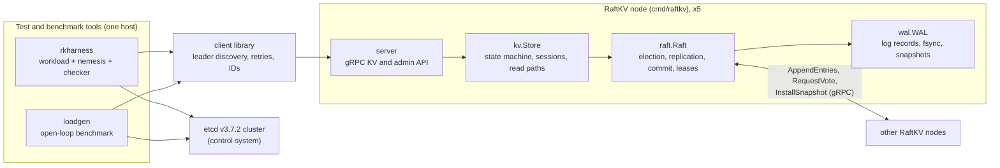
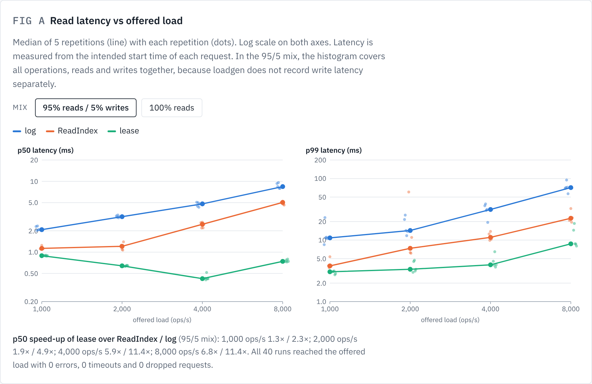
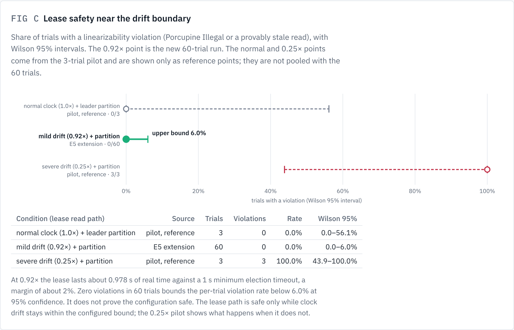
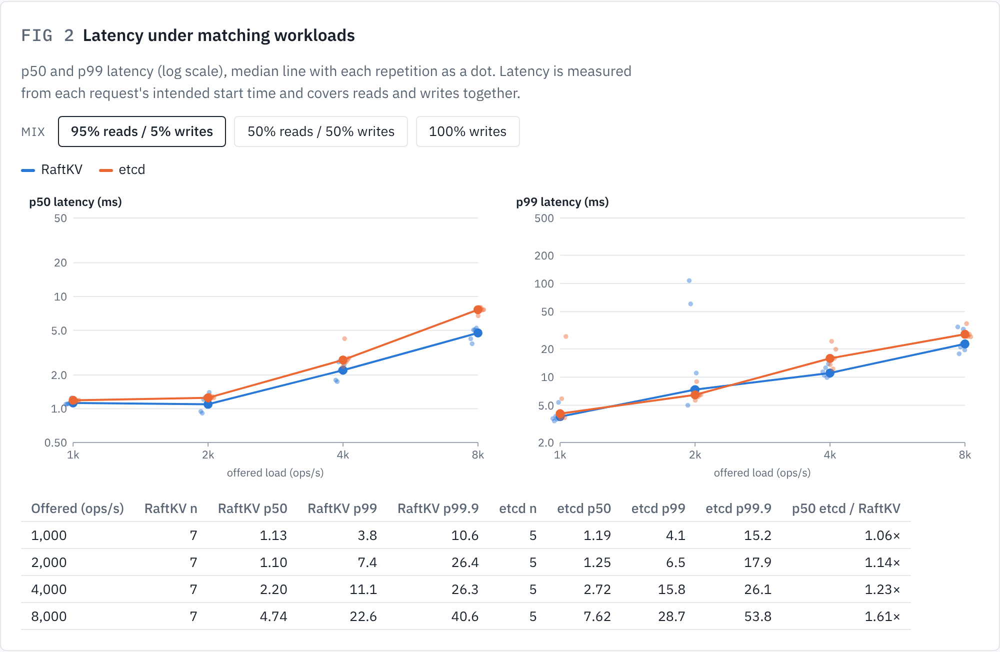

# RaftLab: a Raft key-value store tested against etcd

RaftLab is a research project that builds a replicated key-value store on the Raft consensus algorithm from scratch, then measures how correct and how fast it is, using etcd as the reference system. The store is called **RaftKV**. The repository contains the store, a fault-injection test harness, a load generator, and the raw data and reports of every experiment.

The full research report is [FINAL-REPORT.md](FINAL-REPORT.md).

## 1. Project overview

Distributed databases keep several copies of their data so that they survive machine failures. The hard part is keeping the copies consistent while machines crash, networks split and clocks drift. Raft is a consensus algorithm designed to make this problem understandable, and etcd (the configuration store behind Kubernetes) is one of its best-known production implementations.

RaftLab asks three questions:

1. **Correctness:** does a from-scratch Raft store stay *linearizable* (every operation appears to take effect at one instant between its call and its return) under crashes, partitions, pauses and clock faults?
2. **Cost of correctness:** what latency and throughput does each mechanism cost (log reads vs ReadIndex vs leader leases, batching, pipelining, fsync), and how does that compare with etcd?
3. **Testing efficacy:** how good is the test harness at finding real Raft bugs, measured by deliberately injecting known bugs?

Implementing the store ourselves is what makes these questions answerable: every mechanism can be switched on and off with a flag, and every injected bug can be compiled in.

## 2. Main features

Each feature below was checked against the source code at commit `14bf0f6`.

| Feature | What it does | Where |
|---|---|---|
| Leader election | Randomised election timeouts, check-quorum (a leader that cannot reach a majority steps down), vote stickiness and a vote embargo after restart | `internal/raft/raft.go` |
| Replicated log | AppendEntries with fast conflict backtracking, a leader no-op at the start of each term, optional pipelining (up to 8 requests in flight per follower) | `internal/raft/raft.go` |
| Batching and group commit | Up to 256 entries per AppendEntries and per fsync group (`-batch`, `-batch=1` disables it) | `internal/raft/raft.go` |
| Key-value state machine | `Put`, `Get` and compare-and-set (`CAS`) on string keys, with client sessions (client ID + sequence number) so a retried write is applied once | `internal/kv/store.go` |
| Persistent storage | Own append-only write-ahead log with a CRC-32C checksum per record, torn-tail recovery, fsync before acknowledging, snapshots and log compaction, `InstallSnapshot` for lagging followers | `internal/wal/wal.go`, `internal/raft/raft.go` |
| Three read paths | `log` (the read goes through the log), `readindex` (default; leadership confirmed by one heartbeat round), `lease` (leader lease with a clock-drift bound) | `-read-mode`, `internal/kv/store.go` |
| Seven injectable bugs | One per row of the plan's bug table, compiled in only with `-tags bugs` and switched on with `RAFTKV_BUGS` | `internal/bugs/` |
| Fault injection | `kill -9`, `SIGSTOP`, `iptables` partitions in one Linux network namespace per node, clock faults, lost unsynced writes | `harness/` |
| Linearizability checking | Porcupine checker per key, a sound reduced check after a timeout, and a separate conservative stale-read scan | `harness/checker.go`, `harness/stale.go` |
| Performance benchmarking | Open-loop load generator with HdrHistogram and two backends (RaftKV client, official etcd client), plus a leader-failover mode | `bench/`, `cmd/loadgen` |
| Comparison with etcd | A pinned etcd v3.7.2 is built from source and run under the same harness and load generator | `tools/etcd/` |

Not implemented (outside the plan's scope): membership changes, watches, leases on keys, multi-key transactions.

## 3. Technologies

| Technology | Used for | Status in this repository |
|---|---|---|
| Go 1.26 | Everything: store, harness, load generator | Used |
| gRPC (`google.golang.org/grpc` v1.84.0) | Node-to-node and client-to-node RPC, with a small hand-written binary codec instead of protobuf | Used (`internal/rpc/`) |
| Porcupine v1.3.1 | Linearizability checker | Used (`harness/checker.go`) |
| HdrHistogram (`hdrhistogram-go` v1.4.0) | Latency recording without coordinated omission | Used (`bench/`) |
| etcd v3.7.2 and its Go client | Reference system | Used (`tools/etcd/`, `bench/backends.go`) |
| Linux network namespaces, `iproute2`, `iptables` | One namespace per node, real packet-level partitions | Used (`harness/netns.go`) |
| Python 3 | Aggregation and report scripts | Used (`analysis/`, `results/*/analysis/`) |
| Jepsen, Knossos, Elle | Recommended by the plan | **Not used.** The plan's fallback was chosen: a Go harness with Porcupine. |
| Docker or LXC | Suggested by the plan for isolating nodes | **Not used.** Nodes are separate processes in network namespaces on one host. |
| LazyFS | Lost unsynced writes on crash | **Not used.** Replaced by a WAL mode (`-lazyfs`) that keeps unsynced writes in process memory, so `kill -9` loses them. It applies to RaftKV only. |
| libfaketime | Clock skew | **Not used.** Replaced by an in-process skewable clock controlled over RPC (`internal/clock/`). It applies to RaftKV only. |
| `tc netem` | Network delay | **Not used.** The kernel module was not available, so no delay experiments were run. |

## 4. Architecture

Each RaftKV node is one process with four layers. Clients and the harness talk to any node; followers redirect to the leader.



| Component | Role |
|---|---|
| `cmd/raftkv`, `internal/server` | Node binary; wires the layers together and serves the gRPC API |
| `internal/kv` | Applies committed commands to an in-memory map, deduplicates retried writes, implements the three read paths |
| `internal/raft` | The Raft protocol, with one mutex and one persister goroutine that writes all disk operations in log order |
| `internal/wal` | Durable storage of the log, term and vote, and snapshots |
| `internal/clock` | A clock whose speed and offset the harness can change |
| `client` | Client library used by the harness and the load generator |
| `harness`, `cmd/rkharness` | Starts a 5-node cluster in network namespaces, runs clients and faults, checks the history |
| `bench`, `cmd/loadgen` | Runs fixed-rate load against RaftKV or etcd and records latency |

## 5. How RaftLab works

**Leader election.** Every node starts as a follower. If a follower hears nothing from a leader for its election timeout (a random value between 1 s and 2 s with the default settings), it becomes a candidate, increases its term and asks the others for votes. A node votes at most once per term, and only for a candidate whose log is at least as up to date as its own. The vote is written to disk before it is granted. A candidate with votes from a majority (3 of 5) becomes leader and starts sending heartbeats every 100 ms.

**PUT and log replication.** Example: a client sends `Put("x", "1")` to node 2, which is a follower. Node 2 answers "not leader, try node 4". The client retries on node 4, the leader. Node 4 appends the command to its log, writes it to its WAL, and sends it to the followers in an AppendEntries request. Each follower writes the entry to its own WAL and only then replies "stored up to index N".

**Commit and apply.** When a majority (the leader included) has stored the entry, it is *committed*. Committed entries are applied to the key-value map in log order on every node, and the leader then answers the client. If the leader does not answer in time, the client cannot know whether the write happened. The client library reports this as *indeterminate*, and the harness records it as such, never as a failure.

**GET.** RaftKV offers three ways to serve `Get("x")`, chosen with `-read-mode`:

- **log:** the read is appended to the log like a write. It is correct but costs a full replication round and a disk write.
- **readindex** (default): the leader records its commit index, confirms with one heartbeat round that a majority still accepts it as leader, waits until that index is applied, then reads locally. There is no disk write.
- **lease:** if a majority acknowledged the leader within the last `election timeout × (1 − 0.1)` on the leader's own clock, no other leader can exist yet, so the leader reads locally without any round trip. Otherwise it falls back to ReadIndex. This is safe only while clocks drift less than the configured 10% bound.

**Crashes and recovery.** On restart a node replays its WAL up to the first bad checksum, restores its latest snapshot, and rejoins as a follower. The leader sends it the entries it missed, or a snapshot if they were compacted away. A restarted node refuses to vote for one election timeout, because it may have acknowledged a lease just before it crashed.

## 6. Installation and quick start

### Requirements

- Linux with Go 1.26 (the toolchain version in `go.mod`).
- For the harness and the load generator only: root, `iproute2` and `iptables` (they create network namespaces and firewall rules).
- Python 3 for the analysis scripts.

### Build

```sh
make build                      # binaries into /tmp/raftkv-bin
make build BIN=$HOME/raftkv-bin # or any other directory
```

This builds `raftkv`, `raftkv-bugs` (with `-tags bugs`), `rkharness`, `loadgen` and the pinned `etcd`.

### Run a local cluster (no root needed)

Three nodes on the loopback interface, each with its own data directory:

```sh
P=1=127.0.0.1:7001,2=127.0.0.1:7002,3=127.0.0.1:7003
for i in 1 2 3; do
  /tmp/raftkv-bin/raftkv -id $i -peers $P -data /tmp/rk/n$i 2> /tmp/rk-n$i.log &
done
```

Each node logs JSON to stderr; after about a second one of them logs `became leader`. Useful node flags: `-read-mode log|readindex|lease`, `-batch`, `-pipeline`, `-fsync`, `-lazyfs`, `-snapshot-bytes`, `-election-timeout`, `-heartbeat`, `-log-level`. Stop the nodes with `kill %1 %2 %3`.

### Basic PUT and GET

There is no command-line client. The client library is used from Go, so a short program inside the checkout is enough. Save this as `scratch/kvdemo/main.go` (a scratch folder, not part of the repository):

```go
package main

import (
	"context"
	"fmt"
	"log"
	"time"

	"raftkv/client"
)

func main() {
	conns, err := client.Dial(map[uint64]string{
		1: "127.0.0.1:7001", 2: "127.0.0.1:7002", 3: "127.0.0.1:7003",
	})
	if err != nil {
		log.Fatal(err)
	}
	defer conns.Close()
	c := client.New(conns)

	ctx, cancel := context.WithTimeout(context.Background(), 5*time.Second)
	defer cancel()
	if err := c.Put(ctx, "greeting", "hello raft"); err != nil {
		log.Fatal("put: ", err)
	}
	v, found, err := c.Get(ctx, "greeting")
	if err != nil {
		log.Fatal("get: ", err)
	}
	fmt.Printf("greeting = %q (found=%v)\n", v, found)
}
```

```sh
go run ./scratch/kvdemo     # prints: greeting = "hello raft" (found=true)
```

### Unit tests

```sh
go test -race $(go list ./... | grep -v /results/)   # about 3 minutes, most of it internal/raft
make bugtests                                         # each of the 7 injected bugs must fail its test
```

`make test` (which runs `go vet ./...` and `go test -race ./...`) currently fails to compile. The reason is that `results/E1-E2-2026-10-15/analysis/offline-recheck/` contains archived `zz_*_test.go` files that are meant to be copied into `harness/` and do not build where they are. The command above excludes `results/` and passes.

### Experiments

All experiments need root. Single trials can be run by hand; these are the exact settings used for the final E1, E2 and limited E6 runs:

```sh
B=/tmp/raftkv-bin
S="-bin $B -trials 1 -clients 25 -time 34s -warmup 3s -interval 7s -fault-duration 5s -recover 5s -key-rotate 12s -unique-values"
$B/rkharness $S -db raftkv -fault partition-leader -out results/scratch/E1-partition-leader
$B/rkharness $S -db etcd   -fault partition-leader -out results/scratch/E2-partition-leader
$B/rkharness $S -db raftkv -bugs localread -fault partition-leader -out results/scratch/E6-localread
$B/rkharness $S -db raftkv -read-mode lease -fault clock-partition-mild -out results/scratch/E5-lease-mild
$B/loadgen -bin $B -db raftkv -read-frac 0.5 -rates 1000,2000,4000,8000 -reps 1 -out results/scratch/E3-raftkv
$B/loadgen -bin $B -db etcd -mode failover -trials 10 -out results/scratch/E4-etcd
```

`rkharness -h` and `loadgen -h` list every flag and fault. Other targets:

- `make g1` runs gate G1 (`scripts/g1.sh`: the Raft suite 500 times in each of three modes, sequentially; this takes many hours).
- `make e1` … `make e8` run `scripts/experiment.sh`, which contains the plan's *full* matrices. These targets were not used as they are for the final results: E1 and E2 there use 30 s runs and the harness's default key rotation, and E3, E5 and E7 cover more cells than were run. The final runs used the scripts archived in each results folder's `analysis/` directory (for example `results/E1-E2-2026-10-15/analysis/run.sh`). Those scripts record the exact commands, but they contain absolute paths from the original machine, so set their `BIN`, `OUT` and `DEST` variables before reusing them. Every trial folder also has a `command.txt` with its exact command line.
- `make report OUT=<folder>` writes a summary table of a results folder to `<folder>/REPORT.md` with `analysis/report.py`. Point it only at a new folder: it overwrites an existing `REPORT.md`, and the archived folders' reports are the historical record.

## 7. Research and experiments

| Question | Hypothesis from the plan |
|---|---|
| RQ1 Correctness | — |
| RQ2 Cost of correctness | **H1** Lease reads stay linearizable without clock faults but break under injected clock skew; ReadIndex reads do not. **H3** Most of the throughput gap with etcd comes from batching and disk sync policy, not from Raft itself. |
| RQ3 Testing efficacy | **H2** Partition faults expose more injected bugs than crash faults alone, and combined fault schedules expose the most. |

| ID | Experiment | Status | Commit |
|---|---|---|---|
| G1 | Raft unit suite, 500 runs per mode | **Completed** (1,500 runs) | `3055bd5` |
| E1 | RaftKV linearizability under 9 fault scenarios, 20 trials each | **Completed** | `80f06fc` |
| E2 | Same harness against etcd (control) | **Completed** (8 scenarios; no clock faults, no LazyFS) | `80f06fc` |
| E3 | Latency vs load, RaftKV vs etcd | **Partial**: 3 mixes × 4 loads, 128 B values, uniform keys, 4–7 repetitions; no 4 KB values, Zipfian keys, 3-node clusters or network delay | `14bf0f6` |
| E4 | Leader failover and recovery | **Partial**: kill-leader (10 new + 60 re-analysed events per system) and partition-leader (60 re-analysed events); no snapshot comparison | `14bf0f6` |
| E5 | Read paths: correctness and speed | **Completed at reduced size**: pilot (27 trials, 3 per cell) + 60-trial lease/mild extension + 40 benchmark runs | `14bf0f6` |
| E6 | Injected-bug detection | **Limited**: 2 of 7 bugs, each under its target fault, 20 trials + 20 controls each; the 74-cell matrix was not run | `85a3e22` |
| E7 | Ablation of batching, pipelining, fsync | **Partial**: 50/50 mix at 2k and 8k ops/s, 3 repetitions | `14bf0f6` |
| E8 | etcd unsafe serializable reads | **Not run** | — |

The production code (Raft, KV and WAL) is identical in all of these commits: only tests, scripts, analysis code and results changed after the R-1 fix in `00d9651`.

## 8. Results

Selected findings. Every number is from the reports linked here; the [final report](FINAL-REPORT.md) has the full tables and caveats.

- **G1:** the Raft test suite passed **1,500 of 1,500** runs under the race detector (500 each in the default mode, with `-pipeline` and with `-batch=1`), with no flaky failures. [Report](results/G1-E6-readiness-2026-10-14/REPORT.md)
- **E1:** **180 of 180** RaftKV trials with ReadIndex reads were linearizable (147 Ok, 33 Ok (reduced)), with 0 Unknown, 0 Illegal and 0 provably stale reads, across crashes (including all nodes losing unsynced writes), pauses, three partition shapes, clock skew and mixed faults. The pooled 95% upper bound on the violation rate is 0.02. [Report](results/E1-E2-2026-10-15/REPORT.md)
- **E2:** etcd showed **no confirmed safety violation**: 156 of 160 trials linearizable, 0 Illegal, 0 stale reads. The harness verdicts of the other 4 trials stay as recorded (3 Unknown, 1 checker out-of-memory crash); an offline per-key recheck shows all 4 histories are linearizable. [Report](results/E1-E2-2026-10-15/REPORT.md)
- **E5 correctness:** log and ReadIndex reads were clean under every clock condition. Lease reads were clean at normal speed (3/3) and at a **0.92× clock in 60 of 60 trials** (95% upper bound 6.0%). At a **0.25× clock, far outside the 10% drift bound, lease reads were stale in 3 of 3 trials (75 stale reads)**, all served by the slowed, isolated old leader. This shows what happens when the lease's clock assumption is violated; it is not evidence of an implementation defect. [Pilot](results/E5-pilot-2026-10-16/REPORT.md), [extension](results/E5-extended-2026-10-16/REPORT.md)
- **E5 speed:** with no faults, lease < ReadIndex < log at p50 at all 8 load/mix points, and at p99 at 7 of 8. At 8,000 ops/s of pure reads, p50 was 0.35 ms (lease), 3.17 ms (ReadIndex) and 7.31 ms (log). p99.9 differences are preliminary.
- **Limited E6:** under its target fault, **ackbeforefsync was detected in 19 of 19** completed trials and **localread in 14 of 16**, while the bug-free controls had 0 false positives in 40 trials. Detection came almost entirely from the stale-read scan: Porcupine returned Unknown for most bug trials. [Report](results/E6-limited-2026-10-15/REPORT.md)
- **E3:** RaftKV had **lower p50 than etcd at all 12 tested points** (1.1–2.3× lower), and p99 was mixed. In 1 of 4 write-only repetitions at 8,000 ops/s, RaftKV **collapsed** (3,949 ops/s achieved, p99 1.09 s), and it has **no backpressure**, so overload turns into collapse instead of slower service. etcd did not collapse in any run. In the separate 50/50 overload runs both systems served up to 14,000 ops/s; the trigger of RaftKV's intermittent collapse is not established. [Report](results/RQ2-2026-10-16/REPORT.md)
- **E7:** batching is essential: with `-batch=1`, RaftKV collapsed at 8,000 ops/s in 3 of 3 repetitions. Turning pipelining off gave no measurable loss on one host. Turning fsync off (**unsafe**) roughly halved p50. [Report](results/RQ2-2026-10-16/REPORT.md)
- **E4:** after a leader crash, writes resumed after a median of 1,187 ms (RaftKV) and 1,140 ms (etcd). After leader isolation: 1,504 ms vs 1,219 ms; RaftKV's new leader was elected after 1,255 ms, and the rest is client timeouts on the old leader. [Report](results/RQ2-2026-10-16/REPORT.md)
- **R-1:** a real durability bug in RaftKV, a follower acknowledging entries it had not yet stored, was found by the `bridge-churn` fault, fixed in `00d9651` and covered by deterministic regression tests. [Investigation (Polish)](docs/INVESTIGATION-lost-write.md), [bug journal](docs/BUG_JOURNAL.md)

| Figure | Source |
|---|---|
|  | E5 Figure A: read latency vs offered load (95/5 mix) |
|  | E5 Figure C: lease safety near the drift boundary |
|  | RQ2 Figure 2: RaftKV vs etcd latency (95/5 mix) |

All eight figures are in [`docs/figures/`](docs/figures/). They are PNG exports of the original interactive figure pages, [`results/E5-extended-2026-10-16/figures/e5-figures.html`](results/E5-extended-2026-10-16/figures/e5-figures.html) and [`results/RQ2-2026-10-16/figures/rq2-figures.html`](results/RQ2-2026-10-16/figures/rq2-figures.html), which can be opened locally in a browser.

## 9. Known limitations

- **Single machine.** All five nodes, the clients and the checker run on one 4-vCPU, 16 GB host with one disk. The host is CPU-saturated from about 2,000 ops/s, so absolute latencies and the RaftKV-vs-etcd ordering may not carry over to a real multi-machine cluster.
- **Checker limits.** Porcupine often times out (Unknown) on histories with unique values and violations, and needed up to 13.9 GB of memory per trial; 5 of 40 limited-E6 bug trials and 1 of 160 E2 trials crashed while checking. Unknown and crashes are reported separately, never as passes.
- **No backpressure in RaftKV.** Proposals go into an unbounded queue and timed-out requests are not cancelled, so RaftKV can collapse near 8,000 write ops/s on this host instead of degrading gracefully.
- **Limited E6.** Only 2 of the 7 injected bugs were measured, each under one fault. H2 is untested.
- **Reduced repetitions.** E3 50/50 and write-only used 4 repetitions, E7 used 3, and the E5 pilot cells used 3 trials. p99.9 results are preliminary.
- **Lease assumptions.** Lease reads are safe only while clock drift stays inside the configured bound (10% of a 1 s election timeout). Only 0.92× and 0.25× were tested.
- **Simulated faults.** Clock faults and lost unsynced writes are simulated inside RaftKV, so etcd was not tested under them. The harness snapshots RaftKV every 256 KB of WAL, far more often than the 64 MB default.

## 10. Repository structure and reproducibility

```
cmd/raftkv/         node binary
cmd/rkharness/      fault-injection harness CLI
cmd/loadgen/        benchmark and failover CLI
internal/raft/      Raft core and its tests (G1 suite, durability, persistence audit, bug tests)
internal/kv/        state machine and read paths
internal/wal/       write-ahead log and snapshots
internal/bugs/      the seven injectable bugs
internal/clock/     skewable clock
internal/rpc/, internal/server/   gRPC transport and node wiring
client/             client library
harness/            workload, nemeses, network namespaces, checker, stale-read scan
bench/              load generator backends and failover measurement
tools/etcd/         pinned etcd v3.7.2 build
scripts/            g1.sh, experiment.sh, pilot.sh
analysis/           report.py, stale_reads.py, e6_audit.py
docs/               design notes, bug journal, experiment log, threats, investigations, figures
results/            one folder per run: raw histories, verdicts, logs, analysis, reports
```

| Results folder | Contents |
|---|---|
| [`results/G1-E6-readiness-2026-10-14/`](results/G1-E6-readiness-2026-10-14/) | G1 runs and the E6 readiness audit |
| [`results/E1-E2-2026-10-15/`](results/E1-E2-2026-10-15/) | E1 and E2: 340 trials with histories, node logs and verdicts |
| [`results/E6-limited-2026-10-15/`](results/E6-limited-2026-10-15/) | Limited E6: 80 trials |
| [`results/E5-pilot-2026-10-16/`](results/E5-pilot-2026-10-16/) | E5 pilot: 27 trials and preliminary benchmarks |
| [`results/E5-extended-2026-10-16/`](results/E5-extended-2026-10-16/) | E5 extension: 60 lease trials, 40 benchmark runs, figures |
| [`results/RQ2-2026-10-16/`](results/RQ2-2026-10-16/) | E3, overload, E7, E4, figures |
| [`results/lost-write-2026-10-10/`](results/lost-write-2026-10-10/), [`results/verification-2026-10-11/`](results/verification-2026-10-11/) | R-1 evidence before and after the fix |
| `results/pilot-2026-10-09/`, `rerun-2026-10-09/`, `faults-2026-10-10/`, `final-prep-2026-10-13/`, `scratch-2026-10-09/` | Earlier pilots and smoke runs, kept for history |

Each trial folder holds `history.jsonl` (every client operation), `nemesis.jsonl` (every fault), node logs `n1.log`–`n5.log`, `result.json` (checker verdict and stale-read count) and, in the final runs, `command.txt`. Each results folder has a `REPORT.md` and an `analysis/` directory with the scripts that produced its tables. Reports from earlier dates are kept unchanged; where later runs supersede them, [FINAL-REPORT.md](FINAL-REPORT.md) explains the differences. Some earlier documents (`docs/INVESTIGATION-lost-write.md`, `docs/VERIFICATION-2026-10-11.md`) cite commit hashes from before the history was rewritten for publication; the pre-fix code `9667921` is `e436001` and the fix `cfa86fa` is `00d9651` in this history.
